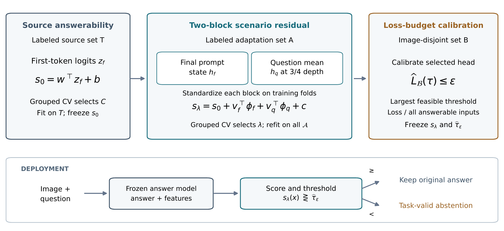

# ReFrain

**Multimodal abstention with explicit preservation of acquired correct answers**

ReFrain adds a budget-controlled abstention stage to a frozen vision-language answerer. The current method adapts a source answerability score with a regularized residual over two representations: the final prompt state and an intermediate question-token mean. An independent calibration set chooses the threshold. At inference, the selector preserves the original response or emits the task's abstention symbol.

The budget counts previously correct answers removed by abstention, divided by all answerable inputs. Repairs do not cancel losses. It constrains empirical calibration loss; the realized loss on new data is measured separately.

## Main results

Both backbones start from their answer-SFT checkpoint B1. MM-UPD E contains 5,626 answerable and 5,052 unanswerable inputs. I is the AI2D-derived transfer set with 912 answerable and 816 unanswerable inputs. The architecture, heads and thresholds transfer to I without fitting there.

At the common 0.5% **realized-loss ceiling**, entries are additional correct abstentions (original-correct losses):

| Backbone / set | Source head | Final-state target LR | Same-feature target LR | ReFrain |
|---|---:|---:|---:|---:|
| Qwen2.5-VL-3B / E | 1,204 (27) | 1,612 (26) | 1,811 (27) | 1,754 (28) |
| Qwen2.5-VL-3B / I | 501 (4) | 500 (4) | 579 (3) | 584 (4) |
| InternVL3-8B / E | 352 (28) | 760 (28) | 958 (28) | 897 (28) |
| InternVL3-8B / I | 126 (4) | 193 (4) | 153 (2) | 193 (4) |

At the independently frozen **0.5% calibration budget**, ReFrain gains 1,762/449 abstentions with 32/0 losses on Qwen E/I, and 1,002/193 with 70/5 losses on InternVL E/I. Circular Dual is 69.02/60.84 and 78.97/66.16, respectively. Circular requires all prescribed option rotations to be correct; these scores are distinct from row-level accuracy.

The question block improves both E frontiers over the final-only residual. Source anchoring has a domain-dependent trade-off: removing it yields higher E gains at the 0.5% loss ceiling, while keeping it gives a stronger transferred Qwen I frozen point (449 versus 306 added abstentions, both at zero losses). All six component controls share the same adaptation/calibration records and current B1 answers.

On open-ended **VizWiz H**, the complete module gains 195 correct abstentions with 14 losses, versus 167 with 15 losses for its source head, at the common 0.5% realized-loss ceiling. The pre-specified conversion difference is +4.65 points [0.17, 9.09]. At the frozen zero-budget threshold it gains 73 versus 59, both with zero observed loss. See the [complete-module VizWiz confirmation](docs/vizwiz-full.md) for the protocol, controls and compact reproduction records.

The data-matched Qwen refusal-SFT control trains on T+A from the same B1 for three epochs: 2,708 examples, 8,124 exposures and 2,031 updates. The T-only control takes 1,017 updates. The two data-matched procedures use the same training-label pool and different compute budgets.

| System | E Circular Dual | E losses / repairs | I Circular Dual | I losses / repairs |
|---|---:|---:|---:|---:|
| Native T+A SFT | 76.58 | 203 / 132 | 71.72 | 6 / 12 |
| ReFrain, frozen 0.5% calibration | 69.02 | 32 / 0 | 60.84 | 0 / 0 |
| T+A margin gate on B1, frozen 0.5% calibration | 72.37 | 18 / 0 | 55.07 | 0 / 0 |

Native T+A SFT has higher Circular Dual. Its final answerable accuracy is 85.71%/92.32% on E/I, versus 86.40%/91.67% for ReFrain. On the common 0.5% realized-loss frontier, ReFrain and the T+A margin gate gain 1,754 (28 losses) versus 1,805 (27) on E and 584 (4) versus 583 (3) on I. Their paired conversion differences are -2.22 points [-9.57, 3.00] and +0.16 [-4.26, 3.73]; the comparisons are not statistically separated. The T+A margin gate retains B1 answers and needs an additional refusal-model prefill. ReFrain uses the existing B1 answer pass.

The earlier T-only sequential and joint-SFT results remain available in the records. Sequential SFT has the higher InternVL I point estimate (70.57 versus 66.16). See the [matched-data reproduction guide](docs/matched-refusal-sft.md) for the complete native, gate, loss/repair and Circular comparisons.

## Method

1. Train the answerer and retain B1. Fit a source answerability head on first-token vocabulary logits from T.
2. Freeze B1 and the source head. Add a residual over final and question states, retaining the source score as a fixed offset. Five image-group folds on A select one shrinkage parameter, including the source-ranking limit at infinite shrinkage.
3. On disjoint B, choose the largest A-score threshold whose original-correct loss meets the chosen calibration budget.
4. Preserve each original answer above the threshold; otherwise return its displayed NOTA letter or an open-answer refusal. Deployment reads features and original answers, without target labels.

Changing the budget recalibrates the threshold without retraining the answering model or residual head. Qwen uses layers 36/27; InternVL uses 28/21. Apply the final RMSNorm to individual question tokens before pooling. The two-block residual contains 4,097/7,169 coefficients including its intercept.



On Qwen MM-UPD E, the complete module adds **1.414 ms [1.282, 1.556]**, or **1.755% [1.582%, 1.939%]**, to end-to-end latency. The measurement uses 500 inputs, three paired repetitions and one RTX6000D; all 1,500 token sequences and veto decisions match the research references. The [online cost guide](docs/online-cost.md) includes the measured integration and CPU verification commands.

## Reproduce the released results on CPU

```bash
pip install -r requirements-scenario.txt
tar -xzf results/two_block_records.tar.gz
OPENBLAS_NUM_THREADS=1 OMP_NUM_THREADS=1 python scripts/verify_scenario_records.py
```

This command recomputes component frontiers, frozen points, per-type results, Circular metrics, unified loss/repair counts and paired 95% intervals from compact row records. It uses 2,000 image-cluster bootstrap draws with seed 20261116 and requires no model weights or images.

The portable fitting entry point defaults to the full two-block method:

```bash
OPENBLAS_NUM_THREADS=1 OMP_NUM_THREADS=1 python scripts/scenario_selector.py fit \
  --adaptation A.npz --calibration B.npz --output fitted/R1b
python scripts/scenario_selector.py apply \
  --head fitted/R1b/head.npz --policy fitted/R1b/policy.json --budget 0.005 \
  --features E_features.npz --answers E_answers.jsonl --output E_routed.jsonl
```

See [scenario adaptation](docs/scenario-adaptation.md) for cache formats, extraction, all six controls and budget changes; [reproduction](docs/reproduction.md) for the original answer-training and source-head pipeline; [datasets](docs/data.md) for image preparation and upstream terms; and the [code index](docs/code-index.md).

[InternVL training](docs/internvl-reproduction.md) rebuilds the InternVL3-8B B1 and its ordinary refusal-SFT model.

The [compact record archive](results/two_block_records.tar.gz) unpacks `results/two_block/` and `splits/`: explicit split/fold IDs, both source heads, all six scenario heads and frozen policies, row-level scores and labels, and the B1 answer texts used for scoring. Original source-only results remain in their existing result directories. The VizWiz source-head confirmation is documented separately in [the open-answer reproduction guide](docs/vizwiz-reproduction.md).

## Related work

The implementation builds on [MM-UPD](https://github.com/AtsuMiyai/UPD), [CLIP-UP](https://github.com/BenVr/CLIP-UP), and linear probing for VLM abstention. [TAPS](https://arxiv.org/abs/2610.16318) studies answer training followed by selection. Baseline adaptations in this repository use the common B1 and task-specific abstention format; their results describe our reproduced configurations.

## Limitations

E and I informed architecture development. VizWiz H confirms the frozen complete module in-domain on one backbone and one answer-training seed; H had previously been used for source-head confirmation. Calibration loss can exceed its nominal budget after transfer: the frozen 0.5% policies incur 0.569%/1.244% loss on Qwen/InternVL E and 0.592% on VizWiz H. Source anchoring does not improve every domain. Question pooling depends on the backbone's input template. Complete-module online latency is measured on one backbone and one multiple-choice dataset. TextVQA transfer covers the source head; cross-format transfer of the complete module is unevaluated. Data-matched SFT comparisons cover Qwen and one seed, with different compute budgets. A non-separated frontier comparison establishes neither equivalence nor superiority.

## License and data attribution

Code uses the [MIT License](LICENSE). MM-UPD, CLIP-UP data, AI2D, VizWiz and model weights retain their upstream terms. Images and model weights are obtained separately from the official sources; they are not bundled with the row records.
